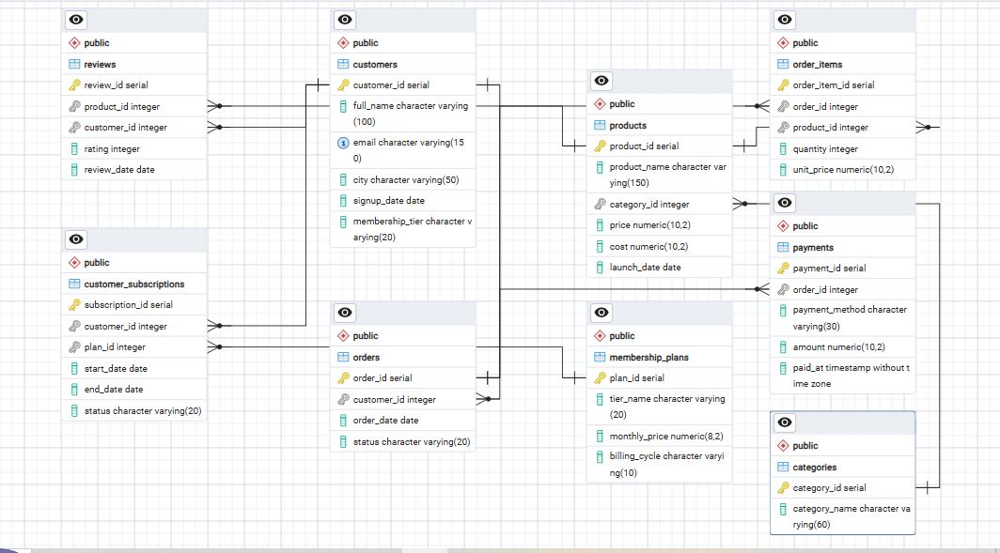
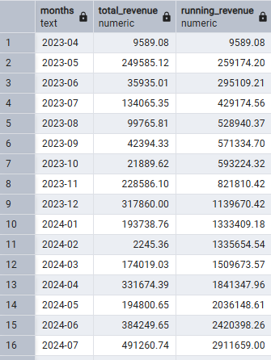
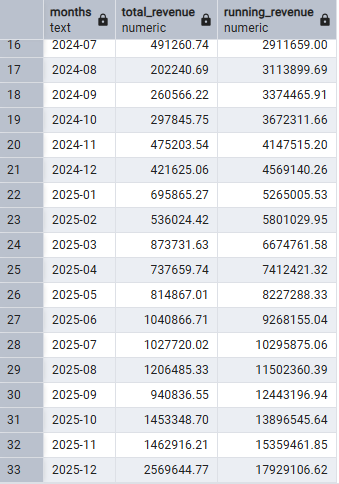
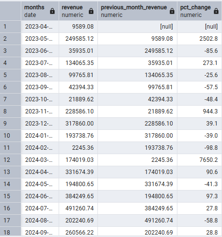
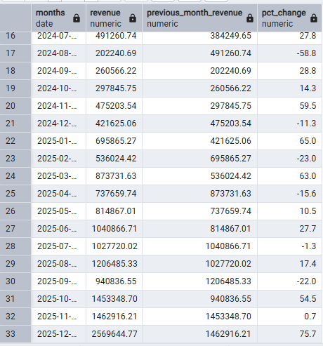
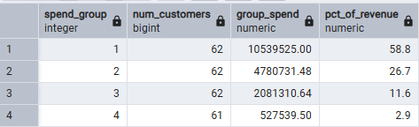
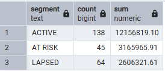

# ShopNest SQL Analysis

A PostgreSQL project on a synthetic Pakistani e-commerce database with a Prime-style membership layer. 20 queries take the data from basic joins through subqueries, window functions and CTEs to answer real business questions about revenue, customer value and churn.

## Overview

ShopNest is a fictional online store with customers across 11 Pakistani cities, a product catalogue in PKR, and a paid Prime membership. I built the 9-table relational database in PostgreSQL 18, loaded it with realistic data, and wrote every query myself, working up from joins to window functions and CTEs.

**Tools:** PostgreSQL 18, pgAdmin 4

## Dataset and Schema

The data is **synthetic**, generated programmatically with Python (Faker) and covering 2023 to 2025. It includes realistic features so the queries have something to find: seasonal sales spikes (11.11, year-end, Ramadan/Eid), cancelled and returned orders, uneven customer activity (some customers barely order, some order often), and Prime subscribers who churn and resubscribe.

| Table | Rows | Description |
|---|---|---|
| customers | 260 | Customer profiles: name, email, city, signup date, membership tier |
| categories | 8 | Product categories (Electronics, Fashion, Groceries, etc.) |
| products | 69 | Products with price and cost in PKR, linked to a category |
| orders | 1,178 | Order headers: customer, date, status (completed, cancelled, returned) |
| order_items | 2,203 | Line items per order: product, quantity, unit price at time of order |
| payments | 1,093 | One payment per non-cancelled order: method, amount, timestamp |
| reviews | 577 | Product ratings (1 to 5) left by customers |
| membership_plans | 2 | Prime plans: monthly (999 PKR) and annual (9,999 PKR) |
| customer_subscriptions | 110 | Prime subscription periods with start/end dates and status |

`order_items.unit_price` stores the price paid at the time of the order, which can differ from the current `products.price`, so historical revenue stays correct when prices change.

## Key Findings

These come from the queries below and describe this synthetic dataset, not real-world markets. Revenue counts completed orders only. Total revenue is 17.93M PKR across 247 customers with at least one completed order, and the totals reconcile across all the queries.

**1. Lahore and Karachi generate 43% of revenue.** Lahore leads at 4.30M PKR, ahead of Karachi at 3.42M, even though Karachi has more customers (49 vs 43). Peshawar is lowest at 0.78M.

**2. Revenue grew from under 10K PKR a month to over 2.5M.** Monthly revenue rose from 9,589 PKR in April 2023 to 2.57M PKR in December 2025, which was up 75.7% on November (the year-end sale). The data starts in April 2023 because the customer base builds up over time.

**3. The top 25% of customers generate 58.8% of revenue.** The top half generates 85.5%, and the bottom quarter just 2.9%.

**4. Prime customers spend about 97% more, by ordering more often.** Prime customers average 6.0 orders and 106,241 PKR each, against 3.0 orders and 53,962 PKR for Non-Prime. Average order value is almost the same (17,673 vs 18,139 PKR), so the gap comes from frequency, not basket size. "Prime" here means a customer who has ever subscribed.

**5. 44% of customers are At Risk or Lapsed, holding 32% of historical revenue.** Measured from the end of the data (2025-12-31): 138 customers are Active (last order within 90 days), 45 are At Risk (91 to 180 days) and 64 are Lapsed (over 180 days). The 109 At Risk and Lapsed customers account for 5.77M PKR in past spend.

### Assumptions

- Revenue = `quantity * unit_price`, completed orders only (unless the query says otherwise).
- Churn is measured from `2025-12-31`, the last date in the data, not from today's date.
- Cancelled orders have no payment record, so payment-method analysis excludes them.

## Query Index

| Tier | Query | Concepts | File |
|---|---|---|---|
| 1 | Completed orders with customer, city and item count | 3-table JOIN, SUM, GROUP BY | `01_joins.sql` |
| 1 | Revenue by product category | 4-table JOIN chain, WHERE, SUM | `01_joins.sql` |
| 2 | Products priced above the overall average | Scalar subquery | `02_subqueries.sql` |
| 2 | Customers who never ordered | NOT IN | `02_subqueries.sql` |
| 2 | Customers with an order over 10,000 PKR | IN, subquery with HAVING | `02_subqueries.sql` |
| 2 | Products above their own category's average | Correlated subquery | `02_subqueries.sql` |
| 2 | Customers who never ordered (rewritten) | NOT EXISTS | `02_subqueries.sql` |
| 3 | Monthly revenue | DATE_TRUNC, GROUP BY, ORDER BY | `03_group_by_having.sql` |
| 3 | Revenue and customers by city | COUNT DISTINCT, HAVING | `03_group_by_having.sql` |
| 3 | Top-rated products (4.0+ with 5+ reviews) | HAVING with two conditions | `03_group_by_having.sql` |
| 3 | Return rate by payment method | CASE inside SUM | `03_group_by_having.sql` |
| 4 | Price rank within category | RANK, PARTITION BY | `04_window_functions.sql` |
| 4 | Top 3 customers per city | RANK, subquery in FROM | `04_window_functions.sql` |
| 4 | Monthly revenue with running total | SUM() OVER, window over aggregate | `04_window_functions.sql` |
| 4 | Month-over-month revenue change | LAG | `04_window_functions.sql` |
| 4 | First order per customer | ROW_NUMBER | `04_window_functions.sql` |
| 4 | Gap between Prime subscriptions | LAG on dates | `04_window_functions.sql` |
| 5 | Customer spend quartiles | CTE, NTILE, SUM(SUM()) OVER () | `05_ctes_capstone.sql` |
| 5 | Prime vs Non-Prime comparison | Chained CTEs, LEFT JOIN, CASE | `05_ctes_capstone.sql` |
| 5 | Customer churn segments | CTE, CASE, date arithmetic | `05_ctes_capstone.sql` |

## How to Run

1. Install [PostgreSQL](https://www.postgresql.org/download/) (this project used version 18, with pgAdmin 4).
2. In pgAdmin, create a database called `shopnest`.
3. Open the Query Tool on `shopnest` and run `sql/00_schema.sql` to create the 9 tables.
4. Import the CSVs from `data/` into the tables (right-click a table, then Import/Export Data, with Header turned on). Load them **in this order**, because of foreign keys: `categories`, `products`, `customers`, `membership_plans`, `customer_subscriptions`, `orders`, `order_items`, `payments`, `reviews`.
5. Check the load with `SELECT COUNT(*) FROM orders;`, which should return 1178.
6. Run the query files in `sql/`.

## Skills Demonstrated

**Database setup and design**
- Installed and configured PostgreSQL and pgAdmin, and built a 9-table normalised schema with primary keys, foreign keys and CHECK constraints
- Loaded data in dependency order to respect referential integrity, and validated the load with row counts and cross-query totals

**Querying**
- Multi-table joins (up to 4 tables) with aggregation and filtering
- Subqueries: scalar, `IN` / `NOT IN`, correlated, and `NOT EXISTS`
- `GROUP BY` and `HAVING` with `CASE`-based conditional aggregation and `COUNT(DISTINCT ...)`
- Date handling with `DATE_TRUNC`, `TO_CHAR` and date arithmetic

**Advanced SQL**
- Window functions: `RANK`, `ROW_NUMBER`, `NTILE`, `LAG`, and running totals with `SUM() OVER`
- Top-N-per-group patterns using window functions inside subqueries
- Chained CTEs for multi-step analysis such as customer segmentation and churn

**Analysis practice**
- Reconciling totals across queries to check correctness (17.93M PKR revenue and 247 customers match everywhere)
- Handling edge cases: safe percentage maths (avoiding integer division), tie-breaking in rankings, NULL behaviour in `NOT IN`, and case-sensitive filters
- Stating assumptions explicitly, such as the churn reference date and revenue definitions
- Turning query output into business findings
